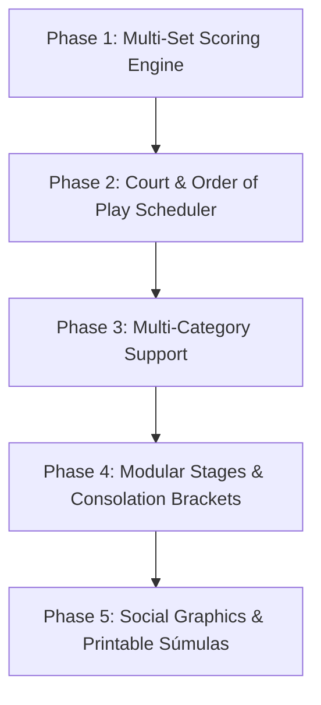

Based on a thorough analysis of `Docs/Best_practice.md` (the deep-dive architectural brief on **Copa Fácil**, the world's leading sports tournament platform with over 5 million downloads) and a review of your current application codebase, here is a strategic evaluation and roadmap of recommendations to elevate your app’s flexibility, scalability, and professional polish.

---

### Current State vs. Benchmark Gap Analysis

| Feature Area | Current Application State | Copa Fácil Benchmark Pattern |
| :--- | :--- | :--- |
| **Competition Hierarchy** | Flat Event model (`/events/[id]`); single bracket/tournament per event. | **Multi-Category Divisions (`with_categories`)**: One tournament hosts multiple independent divisions (e.g. *Open A*, *Intermediate B*, *Women's*, *Mixed*). |
| **Match Scoring** | Scalar score (`scoreA: number, scoreB: number`), ideal for Americano/Mixicano points. | **Array-Based Multi-Set Engine**: `qt_g1: [6, 4, 10]`, `qt_g2: [4, 6, 8]`, tie-break points (`7⁵`), Super Tie-Break (10-pt), and Golden Point (*No-Ad*). |
| **Tournament Phases** | Fixed single-engine generation (Round Robin, Knockout, or hybrid). | **Modular Stage Pipeline ("Nova Fase")**: Dynamic phase builder with Consolation brackets (*Repescagem*), Gold/Silver tier splits, and TBD bracket placeholders. |
| **Court Logistics** | Basic `courtIdx` / `courtName` on matches. | **Court & Order-of-Play Board**: Visual timeline per court (*Quadra Central*, *Quadra 1*), estimated durations, and live pulsating match badges. |
| **Pitch-Side Operations** | Admin-only full access or player self-reporting. | **Delegated Referee Mode**: Lightweight touch-stepper interface for court referees without granting full administrative privileges. |
| **Viral Engagement & Export** | In-app match and standings views. | **Social Media Card Generator** (9:16 Instagram Stories & 1:1 Posts) + **Printable Official Match Sheets (*Súmulas*)** with referee signature blocks. |

---

## 1. Top Architectural Recommendations (For Ultimate Flexibility)

### A. Multi-Category Container Architecture (`with_categories`)

- **The Problem:** In club racquet sports, tournaments are rarely flat. An event like "Spring Padel Open" has Men’s A, Men’s B, Women’s, and Mixed Doubles happening simultaneously at the same club. Forcing organizers to create 4 separate events fragments user registration and court scheduling.

- **Recommendation:**

  1. Add an optional `categories: EventCategory[]` array or subcollection to `EventData`.

  2. Each category encapsulates:

     - Division label (e.g., *"1ª Categoria / Open"*, *"Iniciantes"*).

     - Its own registration limit (`maxPairs`).

     - Distinct scoring configuration (e.g., Beginners play Pro Set to 6 games; Open plays Best of 3 with Super Tie-Break).

     - Its own independent draw and standings.

  3. **UI Implementation:** A persistent **horizontal category pill carousel** (as seen in Copa Fácil) at the top of the event and tournament pages:

     `[ 🏆 Todas ] [ Duplas Masc A (16) ] [ Duplas Masc B (24) ] [ Duplas Mistas (12) ]`

     Selecting a pill instantly filters brackets, matches, and standings with zero page reloads.

### B. Multi-Set Tennis & Padel Scoring Engine

- **The Problem:** Your `TournamentMatchResult` in `src/lib/tournaments/types.ts` (lines 56–63) only records a single `scoreA` and `scoreB`. In real Padel/Tennis matches, sets, tie-breaks, and super tie-breaks are standard.

- **Recommendation:**

  Extend `TournamentMatchResult` with structured set data:

  ```typescript

  export interface TournamentSetScore {

      gamesA: number;

      gamesB: number;

      tiebreakA?: number;

      tiebreakB?: number;

  }

  export interface TournamentMatchResult {

      sets: TournamentSetScore[];    // e.g. [{gamesA: 6, gamesB: 4}, {gamesA: 4, gamesB: 6}, {gamesA: 7, gamesB: 6, tiebreakA: 7, tiebreakB: 5}]

      format: "pro_set" | "best_of_3" | "super_tiebreak" | "points_americano";

      goldenPoint?: boolean;         // No-Ad at 40-40

      status: "scheduled" | "in_progress" | "completed" | "walkover" | "postponed";

      winner: "Side A" | "Side B" | "Draw" | null;

      scoreA: number;                // Aggregate sets won (e.g., 2)

      scoreB: number;                // Aggregate sets won (e.g., 1)

  }

  ```

- **Scorecard Visual Display:** Display tie-breaks as superscripts (e.g., `7⁵`) using standard racquet typography.

### C. Dynamic Stage Pipeline ("Nova Fase") & Consolation Brackets

- **The Problem:** Amateur players dislike traveling to a tournament only to be eliminated in the first 30 minutes. Copa Fácil retains high player satisfaction by automatically offering **Consolation Brackets (*Repescagem*)** and **Tiered Divisions (Gold/Silver Series)**.

- **Recommendation:**

  1. **New Stage Action Button:** Enable organizers to append a new phase to an active event (e.g., advancing from Group Stage to Quarterfinals, or spawning a Consolation bracket from 1st-round losers).

  2. **Advance Strategy Presets:**

     - `divide_group`: Group crossover (1st Group A vs 2nd Group B).

     - `classificacao_geral`: Overall seeding (1st seed vs 16th seed).

     - `consolation`: Automatically routes Round 1 losers into a parallel bracket.

  3. **TBD / Placeholder Brackets (`generate_no_teams`):** Allow brackets to be published *before* pool stages finish with placeholder labels (e.g. `Winner Grupo A` vs `Runner-up Grupo B`). As group scores finalize, winners automatically populate into the bracket in real time.

---

## 2. Professional Operational Features (For Club & Match-Day Polish)

### A. Court Scheduler & Live Order of Play

- **The Problem:** In tournaments with 4–8 courts, organizers struggle with court congestion, match delays, and players asking *"When and where do I play?"*

- **Recommendation:**

  - Create an **Order of Play** board organized by Court tabs: `[Quadra Central] [Quadra 1] [Quadra 2] [Quadra 3]`.

  - Display estimated time slots, current warm-up status, and a pulsating `AO VIVO / LIVE` indicator on the active court.

  - Automatically calculate game intervals (e.g., 60-min or 75-min match estimates) to avoid court overlap.

### B. Referee & Pitch-Side Scorekeeper Interface

- **The Problem:** Giving a court marshal or volunteer referee full event admin rights is risky, but having the head admin manually enter all scores causes severe bottlenecks.

- **Recommendation:**

  - Add an event-level `refereePasscode` or role-based permission (`permissions: string[]`).

  - Provide a distraction-free, mobile-first **Referee Live Dialog**:

    - Large one-thumb `+` / `-` steppers for games and points.

    - Automatic tie-break prompt when a set reaches 6–6.

    - Inline score legality validation (e.g., preventing accidental submission of incomplete sets like 6–5).

    - Instant sync to Firestore so spectators see live score changes immediately.

### C. Printable Official Match Sheets (*Súmula de Partida*)

- **The Problem:** Many clubs and federations require physical match sheets on court clipboards for referee signatures and official record retention.

- **Recommendation:**

  - Add a **Print Match Sheet** button (utilizing CSS `@media print` or a PDF generator) formatted with:

    - Official tournament logo and category badge.

    - Court number, scheduled start time, and round index.

    - Player names, jersey numbers, and seed rankings.

    - Set-by-set boxes, disciplinary/notes section, and referee signature lines.

---

## 3. Growth & Monetization Engine (Viral Loops & Sponsorships)

### A. Automated Social Media Graphic Generator (1-Click Stories & Posts)

- **The Power of Copa Fácil:** Their primary organic acquisition channel is players sharing match result graphics on Instagram Stories and WhatsApp groups.

- **Recommendation:**

  - Add a **Share Graphic** button on completed matches, brackets, and standings.

  - Using HTML Canvas / SVG renderer, export ready-to-share branded images in two aspect ratios:

    - **9:16 (Instagram Story / WhatsApp Status)**: Large player photos, prominent set score lines (`6/4 · 3/6 · [10-8]`), category badge, and tournament title.

    - **1:1 (Instagram Feed / WhatsApp Chat)**: Square match recap card.

  - Include event branding and your app watermark (e.g., *"Managed on [YourApp]"*), creating an organic referral loop for other club directors.

### B. Sponsor Monetization Banner Carousels

- **Recommendation:**

  - Allow organizers to upload local sponsor logos (racket brands, local gyms, sponsors) with outbound URLs.

  - Display non-intrusive sponsor carousels at the bottom of public tournament pages, match cards, and social share exports. This gives organizers a tangible revenue incentive to use your platform over spreadsheets.

---

## 4. Suggested Implementation Roadmap



1. **Quick Win (Phase 1): Multi-Set Scoring Model**

   - Upgrade `src/lib/tournaments/types.ts` and the score modal in `src/app/events/[eventId]/tournament/page.tsx` to support set arrays, tie-breaks, and Super Tie-Break sets.

2. **Operational Core (Phase 2): Court Timeline & Order of Play**

   - Build a court-centric tab view showing live matches and upcoming queues.

3. **Architecture Upgrade (Phase 3): Multi-Category Divisions**

   - Add category scoping so one event can host Open, Intermediate, and Mixed divisions with independent brackets.

4. **Player Satisfaction (Phase 4): Consolation Brackets & Stage Pipeline**

   - Implement "Nova Fase" with automated consolation brackets for first-round losers.

5. **Growth & Polish (Phase 5): Canvas Social Card Generator & Printable Sheets**

   - Add 9:16 / 1:1 image export and print-ready match sheets.

Would you like to start with any specific area first (e.g., the **Multi-Set scoring engine & touch-stepper modal**, or the **Order-of-Play court scheduler**)?
